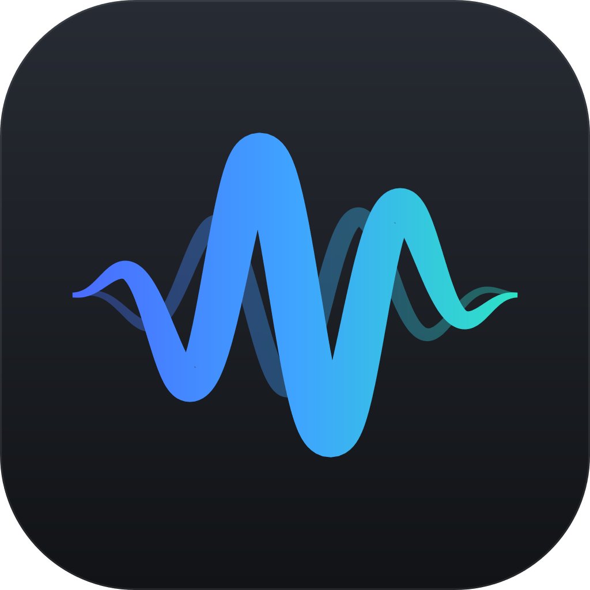

# Onde — v0.6

Une station de travail audio (DAW) au fonctionnement et à l'apparence d'une station professionnelle de type Cubase,
qui ne tombe pas quand un plugin plante : chaque plugin VST3 tourne dans son propre processus. S'il plante ou se bloque,
seule sa piste se tait, et « Relancer » le redémarre avec son dernier réglage.

## Lancer

- **Déjà compilé sur ce PC** : `build-windows\app\Onde_artefacts\Release\Onde.exe` (épinglez-le à la barre des tâches).
- **Recompiler après une mise à jour** : double-cliquez sur `windows\Installer-et-lancer-Onde.bat` (ne recompile que ce qui a changé).
- **Sur un nouveau PC** (Windows 10/11) : clonez le dépôt dans un chemin court (ex. `C:\onde`), puis double-cliquez sur
  `windows\Installer-et-lancer-Onde.bat`. Le script installe Git, CMake et les outils C++ de Visual Studio si besoin,
  télécharge les dépendances aux versions exactes utilisées (Tracktion Engine + JUCE, Eigen, modèles Demucs) dans `deps\`,
  compile, lance les tests d'isolation et ouvre Onde. Première fois : 30 à 60 minutes.

Technologie : C++20, [JUCE](https://juce.com) et [Tracktion Engine](https://github.com/Tracktion/tracktion_engine), CMake,
Visual Studio 2022 (MSVC). Application de bureau Windows (macOS et Linux pas encore testés).

Le dépôt ne contient que les sources : `build-windows\` et `deps\` (≈ 1,5 Go avec les modèles) sont recréés par le script.

## Installateur

Après une compilation : `powershell -File windows\creer-installateur.ps1` (option `-SansModeles` : sans les modèles du
séparateur, ≈ 23 Mo au lieu de ≈ 320 Mo). Produit dans `build-windows\installateur\` :

- `Onde-Setup-<version>.exe` : l'installateur d'Onde (un programme aux couleurs d'Onde, `app/Installer`) : bienvenue, dossier
  et options (raccourcis Bureau et menu Démarrer, ouverture des projets `.onde` par double-clic), progression, « Lancer Onde ».
  Il reconnaît une version déjà installée (mise à jour : projets et réglages conservés), installe pour l'utilisateur courant
  sans droits administrateur dans `%LOCALAPPDATA%\Programs\Onde`, inscrit Onde dans Paramètres › Applications et dépose
  « Désinstaller Onde.exe » (garde les projets ; option pour effacer aussi les réglages). Sans fenêtre :
  `Onde-Setup-<version>.exe --silencieux [--dossier D]`. Le runtime Visual C++ est embarqué.

- `Onde-<version>-portable.zip` : le même programme, à décompresser n'importe où.

L'installateur n'est pas signé : Windows SmartScreen peut demander « Exécuter quand même ».

**Windows et macOS sur GitHub** : `.github/workflows/build.yml` compile Onde sur les machines de GitHub (onglet Actions ›
« Compiler Onde ») : l'installateur Windows et une image disque macOS (`.dmg`, Apple Silicon et Intel). La version macOS est
en préparation : le cœur a sa version POSIX et le code propre à Windows est isolé, mais elle n'a pas encore été compilée ni
essayée sur un Mac. Pousser une étiquette `v0.6` publie une version GitHub avec les fichiers, que la vérification des mises à
jour d'Onde sait lire (dépôt public, ou versions publiées dans un dépôt public réglé dans `parametres.xml`, clé `updateRepo`).

## La fenêtre de projet

| Zone | Contenu |
| --- | --- |
| Barre de menus | Fichier, Édition, Projet, Audio, MIDI, Transport, Studio, Fenêtre, Aide — chaque commande avec son raccourci. |
| Barre d'outils | Zones (gauche / bas / droite), transport, 8 outils (Sélection, Plage, Ciseaux, Colle, Gomme, Zoom, Muet, Crayon — touches 1 à 8), calage (J), grille, quantification. |
| Ligne d'infos | Nom, début, fin, longueur, décalage et état muet de l'événement sélectionné — modifiables par double-clic. |
| Inspecteur (gauche) | Couleur, nom, M / S / ● / moniteur, lecture/écriture d'automation, instrument, volume, panoramique, vumètre, 8 inserts (contourner, retirer, remplacer), envois vers les pistes FX. |
| Pistes | En-têtes avec numéro, type, M / S / ● / moniteur / A (automation), vumètre ; hauteur réglable en tirant le bas de l'en-tête. |
| Règle | Bande de cycle (tirer : nouveau cycle ; poignées L/R ; double-clic : cycle on/off ; Ctrl+clic / Alt+clic : délimiteur gauche / droit), piste des repères, mesures. |
| Zone inférieure | **MixConsole** (inserts, panoramique, M/S/●/moniteur, fader gradué, vumètre avec crête, Stereo Out) et **Éditeur de notes** (zoom, défilement, sélection au rectangle, vélocité, assistant de gamme, écoute des notes). |
| Zone droite | Instruments, effets et fichiers audio (Musique, Documents\Onde, Bureau) : double-clic pour utiliser. |
| Barre de transport | Charge audio, délimiteurs L/R, punch, transport, compteur mesures + temps, métronome, tempo (glisser ou double-clic), signature, sortie stéréo. |

## Fonctions

- **Édition** : sélection multiple (Maj+clic, rectangle, Ctrl+A), déplacement en groupe (Alt : copie, Ctrl : sans calage), rognage des deux bords, couper (Alt+X ou outil Ciseaux), coller (outil Colle), dupliquer (Ctrl+D), copier / couper / coller (Ctrl+C / X / V), muet (Maj+M), annuler / rétablir.
- **Automation** : volume et panoramique par piste (A), points ajoutés / déplacés / supprimés à la souris, appliquée en lecture et à l'export.
- **Pistes FX et envois** : bus d'effet (réverbération ou tout effet), envois post-fader réglés dans l'inspecteur.
- **Mode musical** (Audio › Mode musical, Ctrl+Maj+M, ou clic droit sur un événement audio) : l'événement suit le tempo du projet, étiré en temps réel (SoundTouch) ; son tempo d'origine est celui du projet au moment de l'activation. Marqué « ♪ musical » sur l'événement. Quand le tempo change, tout reste calé sur les mesures comme dans Cubase : conteneurs MIDI, débuts des événements audio (les événements normaux gardent leur durée, les événements musicaux s'étirent), délimiteurs et automation.
- **Piste de tempo** (Projet › Piste de tempo, Alt+T) : clic pour ajouter un changement de tempo, glisser un point pour le déplacer ou changer sa valeur (Maj : réglage fin), double-clic pour le supprimer, clic droit pour choisir saut ou rampe. Règle, grille, compteur, calage et conteneurs MIDI suivent le tempo variable ; la barre de transport affiche le tempo au curseur.
- **Éditeur audio** (zone inférieure, double-clic sur un événement audio ou Ctrl+E) : forme d'onde stéréo du fichier, partie jouée en couleur, règle en mesures, zoom (Ctrl+molette) et défilement ; gain de l'événement, Normaliser (crête à -0,1 dB), Inverser, transposition ±12 demi-tons (durée conservée), fondus d'entrée/sortie par poignées (clic droit : linéaire, convexe, concave, en S) ; glisser pour sélectionner une plage puis « Rogner à la sélection » ou « Supprimer la sélection ». Dans la fenêtre de projet, les événements audio ont aussi leurs poignées de fondu (coins hauts) et de gain (milieu, glisser verticalement). Menu Audio : normaliser, inverser, fondus d'un temps sur la sélection. Tout est non destructif et annulable.
- **Dossiers et groupes** : Projet › Ajouter une piste › Dossier / Groupe, ou Ctrl+Maj+F pour ranger la piste sélectionnée dans un nouveau dossier. Glisser l'en-tête d'une piste pour la réordonner ou la déposer dans un dossier ; clic sur le triangle (ou double-clic dans la bande) pour replier (enregistré avec le projet) ; muet / solo du dossier ; un **groupe** est un dossier de sous-mixage avec son volume et son vumètre (dans l'en-tête et dans la MixConsole). Clic droit sur un en-tête : ranger, sortir, supprimer le dossier avec ou sans ses pistes. Les nouvelles pistes se placent sous la piste sélectionnée.
- **Repères** : Inser. ajoute un repère, Maj+N / Maj+B pour naviguer, pavé 3 à 9 pour les atteindre, renommer / déplacer / supprimer dans la règle.
- **Enregistrement** audio et MIDI, monitoring, punch ; « Enregistrer sous » copie les prises dans « <projet> - Audio ».
- **Projet** : sauvegarde `.onde`, sauvegarde automatique toutes les 15 s, récupération après arrêt brutal, import audio, réglages de la carte son.
- **Export audio** (Fichier › Exporter, Ctrl+Maj+E) : WAV (16, 24 ou 32 bits flottant), FLAC (16 ou 24 bits), MP3 (128 à 320 kbit/s, encodeur de Windows), OGG Vorbis ; 44,1, 48 ou 96 kHz ; normalisation crête (-0,1 dB) ou sonie (-14 LUFS streaming, -23 LUFS diffusion) ; dithering ; tout le projet ou la zone du cycle ; queue de 2 s pour les réverbérations ; export **piste par piste** (un fichier par piste, effets compris).
- **Séparateur de sources** (Audio › Séparer les sources, Ctrl+Maj+U, ou clic droit sur un événement audio) : sépare un événement en **voix, batterie, basse et autres** avec Demucs v4 « fine-tuned » (htdemucs_ft : un modèle spécialisé par source, la référence en qualité). Le calcul tourne dans un processus isolé (`onde-stems`), avec progression, temps restant et annulation ; les 4 sources arrivent dans un dossier « <événement> (séparé) », alignées sur l'événement (gain, fondus et transposition repris), l'original est rendu muet. Annulable d'un bloc. Les fichiers sont écrits dans « Séparations » à côté du projet. Le nombre de calculs en parallèle s'adapte à la mémoire libre ; si elle vient à manquer, le morceau est repris avec moins de calculs en parallèle au lieu d'échouer (« bad allocation »). Deux qualités au choix (la fenêtre affiche la durée estimée) : **Très précis** (les 4 modèles spécialisés ; environ 14 fois la durée de l'audio sur un processeur 4 cœurs Core i5-9300H) et **Rapide** (un seul modèle donne les 4 sources, résidu redistribué pour que leur somme redonne exactement le mix ; environ 2 fois plus rapide). On peut continuer à travailler pendant le calcul.
- **Plugins** : VST3 isolés (◆) avec traitement anticipé (le plugin calcule un bloc d'avance, latence compensée automatiquement), transport transmis (tempo, signature, position, lecture, boucle), latence propre déclarée, mode hors temps réel pendant l'export ; effets Onde (EQ, Comp, Limiteur, Saturation, Écho, Espace) et de Tracktion (chorus, phaser, passe-bas), instruments Onde Synth et 4OSC.
- **Paramètres des VST3 isolés** : tous les paramètres automatisables du plugin apparaissent dans Onde (de 3 à 138 selon les plugins testés), avec le texte du plugin (« -14.4 dB »). Automation, modulateurs, enregistrement avec le projet ; un réglage fait dans la fenêtre du plugin ou un préréglage chargé est suivi par Onde.
- **Automation de tous les paramètres** : le bouton du paramètre de la piste d'automation (ou clic droit) propose le volume, le panoramique et chaque paramètre de chaque effet ; « ● » marque les paramètres déjà automatisés.
- **Télécommande sur téléphone** (Studio › Télécommande (téléphone)…, ou bouton téléphone de la barre d'outils, allumé quand la télécommande est active, avec un voyant vert quand un téléphone est connecté) : le téléphone devient un Stream Deck pour Onde. Activez la télécommande, scannez le QR code (le code d'appairage est gardé d'une activation à l'autre : l'application ajoutée à l'écran d'accueil reste appairée ; bouton « Nouveau code » pour le changer) (même Wi-Fi que le PC, ou Tailscale) : grille de gros boutons avec retour haptique, compteur, tempo et état (lecture, enregistrement, cycle). Pages Transport (lecture, stop, enregistrer, mesure ±1, cycle, métronome, punch, repères), Édition (annuler, rétablir, enregistrer, couper, dupliquer, quantifier, calage, MixConsole…), Pistes (sélection, muet, solo, armement) et Perso : 12 boutons à composer parmi toutes les commandes d'Onde (réglage gardé sur le téléphone). « Ajouter à l'écran d'accueil » l'ouvre comme une application. Sécurité : désactivée par défaut, code d'appairage à 6 chiffres, blocage 30 s après 10 codes faux (les requêtes sans code d'un téléphone qui attend la saisie ne comptent pas), commandes de fichier et « Quitter » non exposées. Au premier lancement, Windows demande d'autoriser Onde sur les réseaux privés.
- **Fluidité** : les vues ne se redessinent que lorsque le projet change ; pendant la lecture, seules la tête de lecture, les compteurs et les vumètres qui bougent sont redessinés, et seuls les événements visibles dans la zone à redessiner sont dessinés.
- **Effets Onde** (inserts, en tête de la liste des effets ; code original, conçu d'après les avis des utilisateurs de mixage) :
  - **Onde EQ** : égaliseur paramétrique 7 bandes, analyseur de spectre en temps réel, points de bande à glisser (fréquence et gain), molette pour la largeur (Q), double-clic pour activer ou désactiver. Coupe-bas et coupe-haut à 12, 24 ou 48 dB/oct. Chaque bande agit au choix en stéréo, à gauche, à droite, sur le Mid ou sur le Side. Les bandes 2 à 6 peuvent être **dynamiques** (seuil, plage) : le gain ne bouge que quand la fréquence dépasse le seuil, et la courbe affiche le réglage et le gain réel.
  - **Onde Comp** : détection crête ou RMS, styles Propre, Opto (relâchement qui s'allonge avec la compression) et Vintage (genou large, saturation douce), relâchement automatique à double enveloppe, liaison stéréo réglable, anticipation de 5 ms (latence compensée), écoute de la détection, filtre coupe-bas de détection, mélange parallèle, courbe de transfert et réduction de gain affichées.
  - **Onde Limiteur** : anticipation 1,5 ms (latence compensée), plafond garanti en **crête vraie** (suréchantillonnage x4, ITU-R BS.1770-4), mesure de sonie EBU R128 (momentanée, court terme, intégrée avec portes -70 LUFS et -10 LU), cible -14 / -16 / -23 LUFS avec écart affiché.
  Paramètres automatisables, enregistrés avec le projet, annulables.
- **Couloirs de contrôleurs MIDI** (éditeur de notes, bouton du couloir du bas) : vélocité, modulation, expression, volume, panoramique, sustain, pitch bend, aftertouch et tous les CC 0 à 127. Dessin libre à la souris, ligne droite avec Maj, clic droit ou gomme pour effacer, « ● » marque les couloirs qui contiennent des données ; pitch bend et panoramique aimantés au centre. Onde Synth répond au volume, à l'expression, au panoramique et à l'aftertouch (vibrato).
- **Geler une piste** (clic droit sur la piste › Geler, ou Ctrl+Alt+F) : la piste et ses effets sont calculés une fois dans un fichier et rejoués tels quels, ce qui libère le processeur ; piste teintée et marquée ❄ ; dégeler pour modifier à nouveau.
- **VCA** (Projet › Ajouter une piste › VCA) : un dossier dont le fader monte ou baisse ensemble toutes ses pistes, sans additionner leur son et en gardant leurs réglages ; fader dans l'en-tête et tranche « VCA » dans la MixConsole.
- **Paroles** (Projet › Paroles, Ctrl+Maj+P) : une phrase par ligne, « [Refrain] » pour un titre de partie ; « Caler pendant la lecture » puis Entrée au début de chaque phrase ; prompteur qui suit la lecture et paroles affichées dans la règle des repères. Enregistrées avec le projet, annulables.
- **Tablature** (zone inférieure, onglet Tablature, Alt+5) : le conteneur MIDI vu et écrit comme une tablature, avec au-dessus la **portée dans la clé de l'instrument** (sol octaviée pour la guitare, fa octaviée pour la basse, sol, ut 3e ligne pour l'alto, fa pour le violoncelle). 17 accordages (guitare standard, drop D, drop C, open G, DADGAD, 7, 8 et 12 cordes, basses 4, 5 et 6 cordes, ukulélé, mandoline, banjo, violon, alto, violoncelle) et **accordage libre** (« Accorder… » : note de chaque corde, de 1 à 10 cordes, clé), retenu pour chaque piste. Clic sur une corde, chiffres pour la case (deux chiffres rapides : 12), ↑↓ change de corde en gardant la note, ←→ avance sur la grille, Suppr efface ; doigté automatique et copie en texte.
- **Mixage professionnel** (MixConsole) : bouton **Ø** d'inversion de polarité sur chaque voie ; sur la sortie, **analyse du mix** (sonie EBU R128 intégrée en grand, momentanée et court terme, crête vraie maximale en rouge au-dessus de -1 dBTP, corrélation de phase avec barre de -1 à +1 pour la compatibilité mono) et boutons d'écoute **Mono**, **-20 dB** et **Réinit.** ; Mono et -20 dB n'agissent que sur l'écoute, jamais sur l'export.
- **Nouvelle piste** (bouton + de la liste des pistes, Ctrl+Alt+T) : de grandes cartes — Instrument, Batteur, Voix ou micro, Guitare ou basse, Instrument VST3, Piste audio vide — et la piste arrive prête (son, chaîne d'effets, armement).
- **Batteur** (MIDI › Batteur…, ou double-clic sur une région de batteur) : 6 styles (pop, rock, hip-hop, électro, funk, ballade), pavé simple ↔ complexe × doux ↔ fort, swing, jeu humain, remplissages toutes les 4 ou 8 mesures suivis d'une crash, éléments joués, nouvelle variation. Le jeu se regénère à chaque réglage ; une même variation redonne le même jeu ; annulable. Deux modes, changeables à tout moment (boutons de la fenêtre ou clic droit sur la région) : **Automatique** (le batteur rejoue à chaque réglage) ou **Notes modifiables** (les notes deviennent les vôtres dans l'éditeur ; modifier une note d'une région automatique la passe en notes modifiables).
- **Chaînes prêtes et commandes rapides** (inspecteur, section « Commandes rapides ») : 14 chaînes (Voix pop, Voix rap, Podcast, Guitare claire, Guitare saturée, Guitare acoustique, Basse ronde, Basse punchy, Batterie punchy, Batterie lo-fi, Nappe large, Lead brillant, Piano chaleureux, Mastering streaming) et de gros boutons qui règlent plusieurs paramètres à la fois (« Présence », « Espace », « Punch », « Saturation »…), plus ceux de l'instrument Onde Synth (« Brillance », « Attaque »…). Automatisables, enregistrés, annulables.
- **Onde Saturation, Onde Écho, Onde Espace** : saturation douce / lampe / bande / fuzz suréchantillonnée ; écho calé sur le tempo (valeurs de note), répétitions filtrées, ping-pong ; réverbération dense à 8 lignes modulées (taille, durée, amortissement, pré-délai, largeur). Chacun a une vraie fenêtre : cartes de caractère, courbe de transfert, harmoniques H1 à H8 et vumètres pour la saturation ; boutons de valeurs de note et frise des répétitions pour l'écho ; courbe de décroissance pour l'espace ; 5 préréglages chacun. Les autres effets intégrés ont une fenêtre Onde avec tous leurs paramètres.
- **Onde Modulation** : chorus, ensemble (3 voix, effet « cordes »), flanger avec réinjection, phaser 6 étages, vibrato ; largeur stéréo ; courbe de l'oscillateur qui défile (gauche et droite) ; 5 préréglages.
- **Paramètres** (Fichier › Paramètres…, Ctrl+,) : Général (écran d'accueil, tempo des nouveaux projets, sauvegarde automatique, dossier des projets), Audio et MIDI (carte son, une entrée par prise, claviers MIDI), Métronome (son créé par Onde, volume, accent, seulement pendant l'enregistrement, décompte), Interface (taille de l'interface de 90 à 150 %, raccourcis), Plugins (VST3 trouvés, ignorés, dossiers analysés, nouvelle analyse), Modèles.
- **Entrées par piste** : chaque piste audio choisit son entrée de la carte son dans l'inspecteur (micro sur l'entrée 1, guitare sur la 2…) ; une entrée par prise, enregistrée en mono au centre (un micro n'est plus enregistré d'un seul côté) ; plusieurs pistes armées enregistrent ensemble, chacune sur son entrée ; plusieurs pistes instrument armées sont jouées et enregistrées ensemble au clavier.
- **Modèles de projet** (écran d'accueil) : Projet vide (aucune piste, la fenêtre « Nouvelle piste » s'ouvre), Groupe (rock, métal : batterie qui joue, basse et deux guitares à l'ampli gauche / droite, voix, chaque piste armée sur son entrée), Beat (hip-hop, électro), Voix et guitare (enregistrées ensemble), Podcast, et Mes modèles. Le projet de démonstration est dans Aide.
- **Onde Ampli** : ampli guitare et basse (code original) : porte de bruit, boost qui resserre le grave, préampli à lampes de 1 à 4 étages suréchantillonné x4, égaliseur (graves, médiums, aigus, présence), étage de puissance, baffle simulé (1x12, 2x12, 4x12, basse 8x10) avec position du micro. Modèles Clair, Crunch, Lead, Moderne, Basse ; préréglages du clair brillant au djent. Utilisé par les chaînes Guitare claire, Guitare saturée, Guitare métal et Basse à l'ampli.
- **Sauvegarde automatique légère** : n'écrit que si le projet a changé (copie de secours en arrière-plan) et affiche « sauvegardé à 14:32 » au lieu d'un compteur redessiné chaque seconde ; fréquence réglable ou désactivée.
- **Mises à jour** : vérification au démarrage une fois par jour (désactivable) et par Aide › Rechercher des mises à jour ; une nouvelle version est signalée dans la barre de titre et la barre d'état, avec son lien de téléchargement. **À propos** : version, date de compilation, nouveautés, mises à jour, crédits et licences.
- **Retour au début** (Origine) et sauts du curseur : la fenêtre de projet suit le curseur.
- **Instruments enregistrés : Onde Échantillonneur et bibliothèques** (MIDI › Bibliothèques d'instruments enregistrés…) : Onde Échantillonneur joue des sons réellement enregistrés au format ouvert SFZ (couches de vélocité, variations « round robin » et aléatoires, échantillons de relâchement, articulations par touches de commutation, boucles, enveloppes, groupes exclusifs, pédale de sustain), avec une carte du clavier (zones, articulations en orange), une liste des instruments installés et un clavier pour essayer. Catalogue de bibliothèques libres à télécharger d'un clic : orchestre VSCO 2 (cordes avec tenues, pizzicati et spiccati, cuivres, bois, percussions), piano à queue Salamander, piano droit, batterie Virtuosity, basses électriques, contrebasse, violoncelle, guitares, saxophone, tuba (licence affichée pour chacune ; CC0 sauf Salamander, CC-BY : citer l'auteur). On peut ajouter ses propres dossiers SFZ.
- **Décompte avant l'enregistrement** : bouton à côté de l'enregistrement (Direct, 1 mesure, 2 mesures ; clic droit : 1 ou 2 temps), aussi dans le menu Transport ; les clics du décompte sonnent même métronome coupé.
- **« Enregistré »** : petit message en bas de la fenêtre à chaque Ctrl+S.
- **Modèles personnels** (Fichier › Enregistrer comme modèle…) : le projet ouvert devient un point de départ (pistes, sons, effets, routage, tempo), avec ou sans ses événements ; « Mes modèles » dans l'écran d'accueil et dans les paramètres (nouveau projet, supprimer, ouvrir le dossier).
- **Fenêtres flottantes** : clavier, bibliothèque, batteur, modulateurs, effets, historique et télécommande ne bloquent plus la fenêtre principale (lecture, sélection et raccourcis restent possibles).
- **Onde Synth et bibliothèque de sons** (MIDI › Bibliothèque de sons, Ctrl+Maj+B) : instrument intégré, sons originaux et rien à télécharger. Cinq moteurs : **cordes pincées** (modèle physique : la corde est simulée, avec la position du médiator, l'attaque, l'étouffement, la caisse folk, classique ou ukulélé, les micros d'une électrique ; guitares 6, 7, 8 et 12 cordes, basses, contrebasse, harpe, ukulélé, justes au centième près), analogique (2 oscillateurs, sous-oscillateur, bruit, unisson jusqu'à 7 voix, filtre 24 dB résonant), FM (pianos électriques, cloches), piano (26 partiels inharmoniques, deux cordes, marteau, étouffoir et sustain, table d'harmonie ; piano à queue, piano droit, piano de concert), batterie synthétisée (notes General MIDI, kits acoustique / 808 / électro). 46 sons en 10 familles : pianos, claviers, guitares, basses, nappes, cordes et cuivres, cordes pincées, leads, cloches et percussions, batteries. **Fenêtre de l'instrument** : navigateur de sons (recherche, familles, son précédent / suivant, un clic fait entendre le son), affichage propre au moteur (forme d'onde et filtre, harmoniques FM, partiels du piano, pads de batterie à jouer, corde et position du médiator), réglages rangés par sections avec courbes d'enveloppe, et un clavier pour essayer le son. Un clic pose le son sur la piste et le fait entendre ; une nouvelle piste instrument démarre sur « Piano de concert » ; le modèle « Beat » s'ouvre avec batterie, 808, accords et mélodie prêts à jouer.
- **Clavier** (MIDI › Clavier, Ctrl+Maj+K) : jouer sans clavier MIDI, à la souris ou avec le clavier de l'ordinateur (AZERTY ou QWERTY : Q S D F G H J K L M et Z E T Y U O P ; W / X octave, C / V vélocité, Tab sustain). Les touches portent leur lettre. Les notes jouent l'instrument de la piste sélectionnée et s'enregistrent comme celles d'un clavier MIDI.
- **Modulateurs** (Projet › Modulateurs de la piste…, Ctrl+Maj+L, ou clic droit sur une piste) : LFO (11 formes, libre, calé sur le transport ou relancé à chaque note, cadence en hertz ou en valeurs de notes), pas à pas (jusqu'à 64 pas à dessiner), suiveur d'enveloppe (ducking : il suit le niveau d'une piste et peut agir sur une autre) et aléatoire. Chaque modulateur s'affecte à n'importe quel paramètre (volume, panoramique, réglages des effets Onde et Tracktion) avec une profondeur de -100 à +100 %, plusieurs affectations possibles. Oscilloscope en direct, enregistré avec le projet, annulable.
- **Comparatif avec Cubase Pro** et feuille de route : [docs/comparatif-cubase-pro.md](docs/comparatif-cubase-pro.md).
- **Historique des modifications** (Édition › Historique des modifications) : toutes les actions du projet dans l'ordre, l'état actuel en surbrillance, les étapes annulées en grisé ; un clic ramène le projet à n'importe quelle étape.
- **Rendre définitif** (Audio › Rendre définitif, ou bouton de l'éditeur audio) : réécrit l'événement tel qu'il sonne (gain, fondus, inversion, transposition, mode musical ; sans les effets de la piste) dans un nouveau fichier qui le remplace, au même endroit. Annulable. Fichiers dans « <projet> - Audio ».
- **Écran d'accueil** (au démarrage, ou Fichier › Écran d'accueil, Ctrl+Maj+H) : modèles de projet (vide, Groupe, Beat, Voix et guitare, Podcast, Mes modèles), projets récents (double-clic pour rouvrir), Ouvrir…, et « Afficher au démarrage » à décocher.
- **Projet neuf** : un projet créé ou ouvert n'est pas marqué « modifié » tant que vous n'y touchez pas (pas de question inutile à la fermeture).
- **Plantage** : si Onde s'arrête brutalement, la pile d'appels est écrite dans `%APPDATA%\Onde\plantage.txt` (diagnostic).
- **Logo** : une onde dont l'amplitude enfle puis s'éteint, en ruban effilé bleu → turquoise (`app/Resources/logo.svg`, vectoriel). Icône de l'application (générée par `Onde --render-logo <dossier>`, PNG de 16 à 1024 px), fenêtre « À propos », barre d'outils, et page du téléphone (icône d'onglet et d'écran d'accueil).
- Toutes les commandes : Ctrl+K (recherche) et F1 (liste des raccourcis).

## Tests automatiques

| Test | Commande | Résultat |
| --- | --- | --- |
| Isolation du cœur | `onde-sandbox-test onde-plugin-worker` | plantage détecté, plugin bloqué arrêté, piste voisine intacte |
| Vrai VST3 | `onde-vst3-test onde-plugin-host <synth.vst3> <crash.vst3>` | 10/10 |
| Plugins installés | `Onde --plugin-test <dossier>` | chaque VST3 du PC : chargement isolé, son, fenêtre, réglage sauvegardé, paramètres exposés (réglés depuis Onde, suivis au chargement d'un préréglage), automation audible au rendu, 3 s de lecture en temps réel sans retard (7/7 sur ce PC, dont Archetype (Neural DSP), Valhalla Supermassive, TDR Nova ; SSDSampler5 muet tant qu'aucun kit n'est choisi) |
| Interface | `Onde --ui-test <dossier>` | 154/154 : Onde Échantillonneur (Ré 4 juste à 0,01 Hz près depuis l'échantillon de Do 4, couches de vélocité, variations, relâchement, articulations, installation depuis une archive), message « Enregistré » et décompte ; entrées par piste (deux pistes armées sur deux entrées), modèles de projet, sauvegarde automatique (rien écrit sans changement), métronome, mises à jour, Onde Ampli (clair propre, moderne saturé, porte), tablature (accordage libre, portée et clés), télécommande sans blocage ; cordes pincées justes (Fa♯ grave de la 8 cordes à 46,25 Hz, nylon, folk, basse, harpe, à 0,5 centième près), Onde Modulation (5 effets, crête maîtrisée), modèles personnels (avec et sans événements), paramètres, essai du son depuis la fenêtre de l'instrument, analyse du mix (-20,00 LUFS pour un 1 kHz à -20 dBFS, corrélation +1, Mono et -20 dB sans effet sur l'export), polarité Ø (corrélation -1,000 au rendu), batteur automatique ↔ notes modifiables, geler, VCA, paroles, tablature, couloirs MIDI (expression dessinée : -120 dB puis -22 dB au rendu, pitch bend au maximum : La 440 → 493,88 Hz, annuler, réouverture), palette (sons, chaînes, types de piste), batteur (styles, complexité, intensité, remplissages, variations, région regénérée et annulable, son), nouvelle piste à cartes, fenêtres non modales, Onde Saturation (harmoniques), Onde Écho (noire à 500,0 ms à 120 BPM), Onde Espace (durée de réverbération, stéréo), chaînes (pose, remplacement, annuler, réouverture) et commande rapide audible au rendu ; Onde Synth (30 sons jouent sans saturer, La 440,00 Hz à l'orgue et au piano, grosse caisse grave et charleston aiguë, son annulable et enregistré), annuler un réglage remet le son, bibliothèque, modèle « Production » ; automation d'un paramètre d'effet (0 dB puis +11,9 dB au rendu) ; modulateurs (LFO carré 2 Hz sur le volume : 16,3 dB de variation au rendu, fenêtre et cartes, enregistrés avec le projet, annuler) ; effets Onde (EQ : cloche +11,9 dB pour +12, coupe-bas -80 dB à 100 Hz, pentes 12 dB/oct -40,0 dB et 48 dB/oct -128 dB, canaux gauche / droite / mid / side, bande dynamique -6,00 dB pour -6 ; Comp : -19,49 dBFS pour -19,5 attendus, RMS -17,27 pour -17,25, anticipation 5 ms, opto ; Limiteur : crête -1,00 dBFS, latence 1,5 ms, sonie -20,00 LUFS pour un 1 kHz à -20 dBFS, crête vraie -1,00 dBTP au plafond -1 sur un signal inter-échantillons ; réglages enregistrés), historique des modifications, rendre définitif (même son à 129 dB), écran d'accueil (modèles, projets récents), télécommande (vraies requêtes HTTP : page, code exigé, état, commandes, pistes, refus des commandes dangereuses, blocage après 10 codes faux, QR code), mode musical (étirement réel au tempo doublé, MIDI et audio recalés sur les mesures, annuler), repli des dossiers enregistré, vumètre de groupe ; export WAV / FLAC / MP3 / OGG lisibles, normalisation à l'export, export piste par piste ; éditeur audio (gain, fondus, normaliser, inverser, transposer appliqués au rendu ; supprimer / rogner une plage), dossiers (muet effectif au rendu), groupes (volume effectif au rendu), annuler ; piste de tempo (sauts, rampes, compteur, annuler), pistes, événements, outils, sélection multiple, copier/coller, automation appliquée au rendu, pistes FX et envois audibles, repères, enregistrer / rouvrir (audio retrouvé), export, plantage et relance |
| Séparateur | `Onde --stems-test <dossier>` | sur le projet de démo (mix à 48 kHz) : très précis : SDR batterie 28 dB, basse 28 dB, autres 13,6 dB, aucune voix inventée (-46 dB), somme des sources = mix (31 dB) ; rapide (`ONDE_STEMS_MODE=rapide`) : batterie 15,3 dB, basse 17,6 dB, autres 12,3 dB, somme exacte, import aligné, original muet, annuler |
| Fluidité | `Onde --perf-test <dossier>` | projet de 14 pistes / 96 événements joué sur la carte son, une mesure par vue : fil de l'interface 17 à 24 % d'un cœur (56 à 63 % avant optimisation), processus ≈ 50 % (≈ 145 % avant), charge audio ≈ 6 % ; `ONDE_PERF_PROFILE=1` ajoute le profil des fonctions les plus coûteuses ; coût de chaque effet et moteur Onde en % d'un cœur (EQ 1,5 %, Comp 0,9 %, Limiteur 1,3 %, Saturation 2,8 %, Écho 0,4 %, Espace 1,5 %, Onde Synth 3 à 11 % pour 8 notes) |
| Temps réel | `Onde --live-test <dossier>` | lecture sur la carte son, clavier d'Onde (une note fait sonner la piste, Do-Mi-Sol joués pendant l'enregistrement retrouvés dans la prise), son au master, vumètre de la tranche de groupe, enregistrement d'une prise, copie de la prise à l'enregistrement du projet |

Traces de diagnostic : définir la variable d'environnement `ONDE_TRACE=1`.

## Limites connues

- Pas encore : macOS.
- MP3 : encodeur de Windows (Media Foundation), 44,1 ou 48 kHz uniquement ; ailleurs, choisir FLAC ou OGG.
- Séparateur : les sources de demucs.cpp (MIT) sont dans `app/Worker/demucs`, réécrites par endroits pour MSVC (normalisations, softmax, im2col : mêmes calculs, résultats identiques à 60 dB près) ; les 4 modèles (≈ 340 Mo, `deps/demucs-models`) sont copiés à côté d'Onde dans `modeles-demucs`.
- Les VST3 de type effet ne reçoivent pas le MIDI.
- Licence : Tracktion Engine et JUCE sont GPLv3 ou commerciaux ; distribuer Onde impose l'un ou l'autre.

